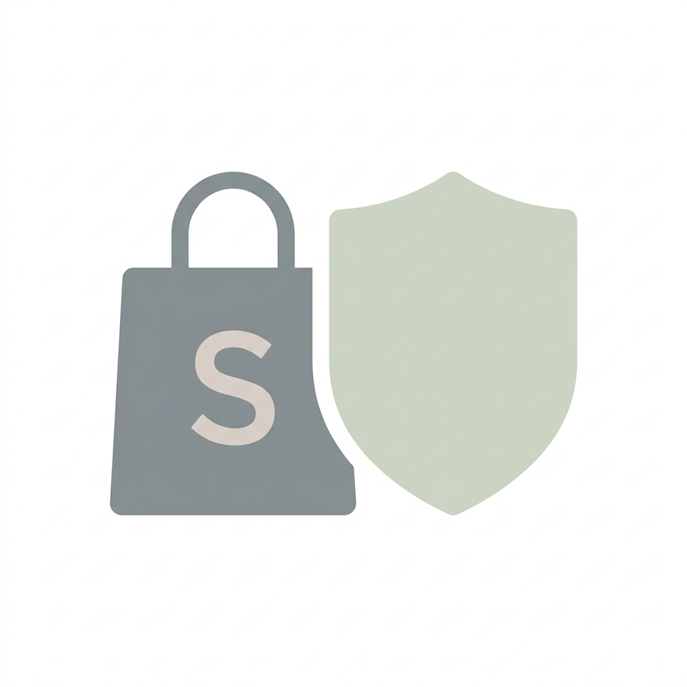

  

# 🛍️ Shopping Block

### 🚧 Work in Progress
This app is currently in active development. Features are being added and refined frequently.

---

> **Protect Your Wallet. Think Before You Buy.**

**Shopping Block** tries to auto-detect shopping carts to prevent you from mindless shopping. Also allows you to hard close custom sites all together!

---

## 🧠 The "Think About It" System

When you hit a retail site or a checkout flow:
1. **Detection**: Heuristics identify shopping-related activity.
2. **The Timer**: A customizable countdown appears, forcing a period of reflection.
3. **Choice**: After the timer ends, you decide if the purchase is truly necessary.

---

## ✨ Key Features

- **🛡️ Checkout Protection**: Specifically targets the "Add to Cart" and "Checkout" funnels.
- **⏳ Reflection Timer**: Multi-unit duration input (seconds, minutes, hours).
- **📑 Full Block List**: Instantly close tabs for sites you know are your biggest weaknesses.

## 🛠️ Installation

1. Clone this repository.
2. Open Chrome and navigate to `chrome://extensions/`.
3. Enable **Developer Mode**.
4. Click **Load unpacked** and select the `Shopping Block` folder.

---

*Co-Coded with Google Gemini* ✨
